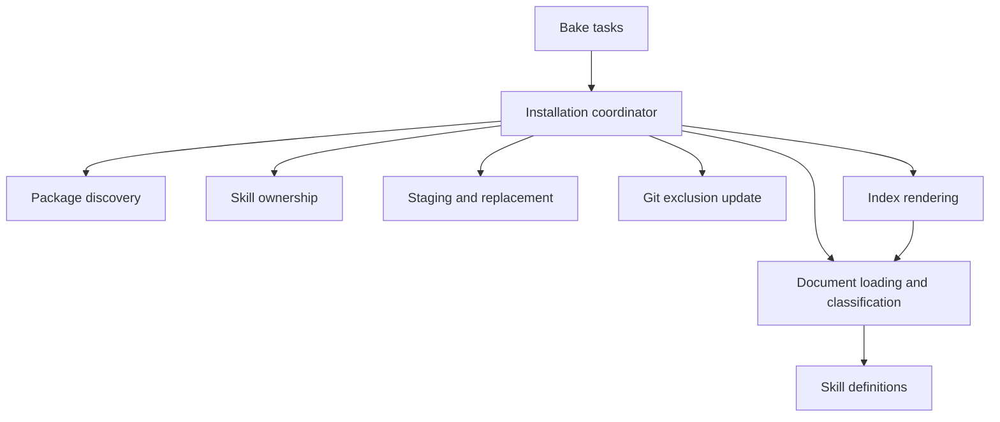

# Agent Context Design

This document proposes a common architecture for the Ruby `agent-context` gem and Rust `bake-agent-context` crate. It explains the boundaries that should make both implementations easy to understand and change together.

The [specification](specification.md) defines the portable file formats and installation behavior. This design describes implementation responsibilities. The current-state comparison refers to Ruby PR #4 and Rust PR #30; the target architecture and implementation sequence below are proposed work.

## Current Architecture

The implementations share the provider layout, metadata-declared skills, per-directory `skill.json` ownership, and generated Markdown index. Their internal boundaries differ:

| Concern | Ruby today | Rust today |
| --- | --- | --- |
| Dependency discovery | Both installers enumerate gem specifications and build provider hashes. | `Installer::discover` resolves Cargo metadata and stores `ContextPackage` values. |
| Document interpretation | `Document` wraps Markly, YAML metadata, body extraction, title, and description. It also contains index ordering. | `index::extract_content` and `skill::parse_skill_document` parse independently. Generic front matter helpers live in `skill.rs`. |
| Index entries | The index retains parsed `Document` objects during rendering. | The private `ContextDocument` contains only a path, title, and description. |
| Skill definitions | `Skills::Definition` stores generated instructions and provider details, and writes staged files. | `Skill` stores metadata, body, and its package. Functions in `skill.rs` discover, validate, stage, reconcile, and replace skills. |
| Ownership and Git | `Skills::Ownership` and `Skills::Exclusion` are separate classes. Both index and skill installation use exclusions. | Ownership lives in `skill.rs`; Git exclusions live in `exclude.rs`. |
| Installation sequence | The library coordinates metadata validation, skills, context, and index updates. Ordinary context uses staged directory replacement. | The Bake task coordinates context, skills, and index updates. Ordinary context removes its destination before copying. |

Ruby retains the original Markdown body when generating skill instructions. Rust currently renders the body from its Markdown AST. Ruby supports provider-authored `index.yaml` overrides; Rust currently derives its index from documents and package descriptions.

The main design issue is overlapping ownership of work. Indexing depends on skill code for generic parsing in Rust; ordinary context discovery depends on full skill discovery in both implementations. Installation and discovery also share large implementation units. Formatting helps readers, but these boundaries determine how much code they must understand to make one change.

## Design Principles

- Give each domain rule one owner, shared by all commands that need it.
- Align responsibilities, data flow, and observable behavior across languages. Use idiomatic Ruby objects and Rust types, modules, and functions.
- Keep construction limited to storing supplied state and cheap normalization. Name operations that read, parse, discover, prepare, or install explicitly.
- Keep coordination methods readable as a sequence of domain operations. Extract helpers around cohesive responsibilities and use whitespace to separate phases.
- Keep recovery proportional to the operation: validate first, stage replacements, and restore the affected directories when replacement fails.

## Proposed Boundaries

These boundaries can be expressed with existing objects and small cohesive modules. Keep related helpers together when they have the same owner.

| Boundary | Responsibility | Ruby shape | Rust shape |
| --- | --- | --- | --- |
| Package discovery | Resolve dependencies and produce package identity, description, selector, and context root. | A package value shared by both installers; gem discovery at the boundary. | Existing `ContextPackage`; Cargo discovery functions. |
| Document | Interpret one Markdown source and its front matter. | `Document`. | A parsed `ContextDocument` in its own module. |
| Skill definition | Apply skill rules to a document and package; describe instructions and companion resources. | `Skills::Definition`. | `Skill`. |
| Installation | Select providers, classify files, validate destinations, stage content, and replace installed directories. | `Installer` and `Skills::Installer`. | `Installer` and focused skill installation functions. |
| Skill ownership | Read, validate, write, and scan per-directory ownership records. | `Skills::Ownership`. | An ownership module containing `SkillOwner` and its operations. |
| Git exclusion | Prepare, apply, and restore the consuming project's exclusion block. | `Exclusion` under `Agent::Context`. | `exclude::Update` and preparation functions. |
| Index | Order ordinary documents, apply provider overrides, and render links and summaries. | `Index`. | `ContextIndex`. |
| Bake tasks | Translate arguments, call library operations, and format results. | `bake/agent/context*.rb`. | Task adapters exported from the crate. |

Package values carry ecosystem, package name, version, description, context root, and the selector needed by their ecosystem. Cargo can distinguish resolved versions; gem discovery uses the active specifications. A selector identifies a provider to the user; ownership retains the package name and version defined by the specification.

Index rendering and skill definition both consume the document abstraction. Package resolution, directory traversal, destination mutation, and Git commands belong to the operations that explicitly perform those effects.

## Document Contract

`Document.load(path)` / `ContextDocument::load(path)` read a source file and delegate to `parse`. `parse(content, path)` interprets already supplied text, using the path for diagnostics and filename-derived values. Constructors retain the resulting state.

The document exposes:

- The source path and original content.
- Decoded front matter, including additional provider metadata.
- The declared document kind: ordinary guidance or a skill.
- A title from the first nonempty heading, with a filename fallback.
- A description from explicit metadata or the first prose sentence.
- The original body after the front matter recognized by the Markdown parser.

Markly and `socketry-markdown` own Markdown syntax and front matter recognition. YAML decoding and context metadata interpretation live in the document layer. That layer reports malformed metadata and unsupported declared kinds with source locations. Skill-specific name, required description, and length checks belong to the skill definition.

Both implementations should preserve the source body when generating `SKILL.md`, using the parser's source positions to identify the front matter boundary. Only the generated front matter and its separator need serialization. Shared fixtures should cover formatting, links, fenced blocks, Unicode, and line endings.

Move Ruby's canonical document ordering to the index. Replace Rust's index-only `ContextDocument` with the parsed document abstraction; an index entry can retain a relative path and extracted display values when useful.

## Discovery and Installation

Resolve package metadata once for an operation and pass the resulting values through context and skill processing. For each selected provider, inspect root-level Markdown declarations first. Classify companion skill directories before traversing other context paths; their contents are opaque resources. Reuse that classification for listing, showing, copying, and skill installation.

The main library operation follows these phases:

1. **Discover:** select packages and classify their context files into ordinary files and skill definitions.
2. **Validate:** check selected document metadata, skill rules, resource paths, ownership, and destination collisions before replacement begins.
3. **Stage:** copy ordinary files with their relative paths; write each skill's `SKILL.md`, resources, and `skill.json` together.
4. **Replace:** publish staged provider directories and the selected skill batch; reconcile stale skills within the requested ownership scope.
5. **Index:** load the installed ordinary documents and render `.agents/context/index.md`.

Git exclusion preparation happens before replacement. Skill installation applies its prepared update within the skill replacement boundary so its existing restoration behavior remains explicit. Index refresh can prepare the context exclusion update through the coordinating operation. Rendering the index itself consumes documents and package descriptions.

Each ordinary provider replacement and the selected skill batch has its own rollback boundary. A complete refresh is incremental: successful earlier phases remain installed if a later phase fails, and rerunning the command refreshes the remaining outputs. This keeps the failure model understandable with temporary directories, renames, and local restoration.

`skill.json` remains the ownership authority. Scanning installed directories supplies reconciliation and exclusion inputs. The ownership module handles the record format; the installer decides which ecosystem, package, or named skill the operation selects.

## Alignment Decisions

The shared specification is authoritative for portable behavior. The Rust implementation remains a useful reference for the package model and metadata-driven workflow; the Ruby document abstraction provides the common parsing boundary. Changes to either implementation should be evaluated against the shared design.

The first alignment pass should preserve existing supported behavior while moving responsibilities. Subsequent behavior changes should be explicit and covered by common fixtures:

- Preserve skill body source formatting in Rust, matching the proposed document contract.
- Use staged replacement for ordinary context in Rust, matching Ruby's provider replacement boundary.
- Bring the full installation sequence into the Rust library so Bake tasks delegate orchestration consistently.
- Treat provider-authored `index.yaml` as an optional index input. Keep its interpretation in the index layer; Rust support is a separate parity task. The generated artifact remains `index.md`.

Dependency resolution and command option names can remain ecosystem-specific. Shared fixtures should check document interpretation, generated skill metadata and body, ownership scopes, reserved resource names, index content and ordering, and replacement outcomes. Match semantics explicitly; introduce byte-for-byte assertions where exact source preservation is part of the contract.

## Implementation Sequence

1. Introduce the Rust parsed document module and route both indexing and skill discovery through it. Move ordering into Ruby's index.
2. Share provider values and file classification within each implementation so ordinary context and skills use the same discovery result.
3. Separate Rust ownership and installation operations from skill definition code. Move Ruby Git exclusions to the context namespace.
4. Align orchestration and replacement boundaries, then address the listed output differences with shared fixtures.

For each step, update the current-state comparison and validate the affected public commands. Keep new helpers private until callers need a public contract. Promote the general lessons about construction, responsibility, readability, and cross-language alignment into the shared Socketry conventions.
